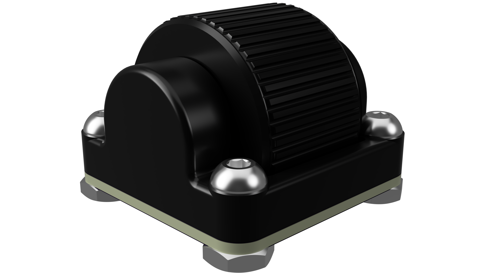
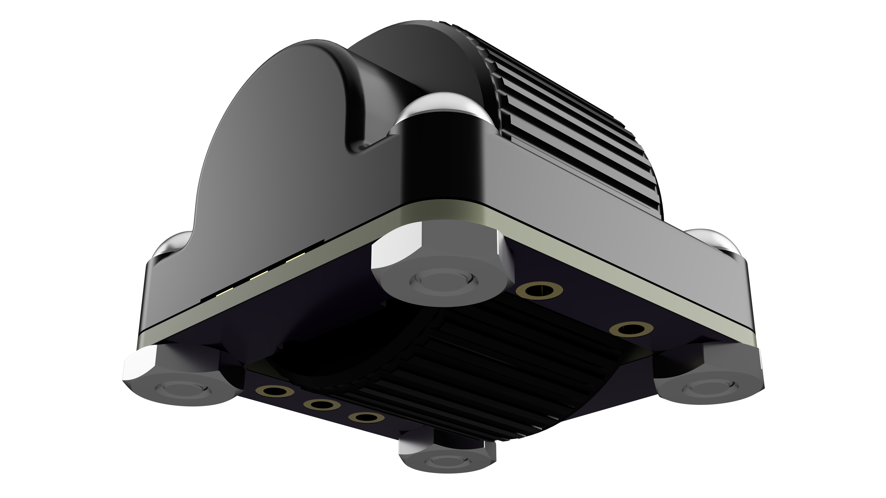
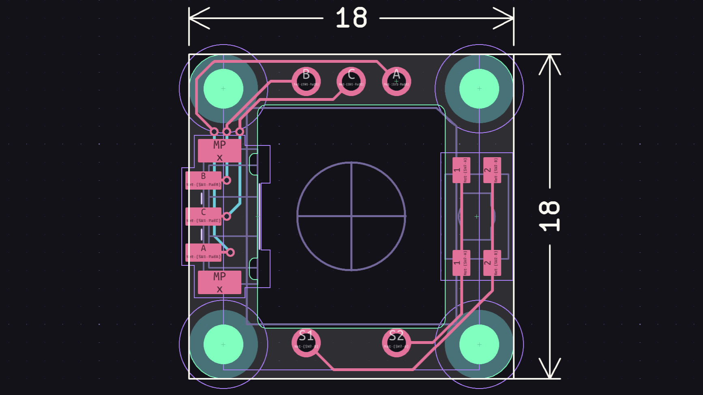

# Hami
1U EVQWGD001-like rotary encoder module with standard EC11 pinout.

## Disclaimer
This module is licensed under [CERN-OHL-S-2.0](https://cern-ohl.web.cern.ch/). It is also untested.

## Key Features
* Large 15x10mm knob.
* 18x18mm footprint with standard EC11 pinout.
* Requires only four screws and nuts to assemble.

## Changelog
* 2026/10/24: Initial V0.1 commit.