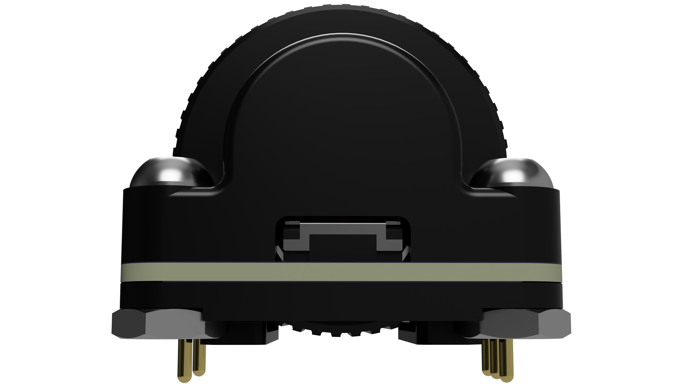

# Hami
1U EVQWGD001-like rotary encoder module with standard EC11 pinout.

## Disclaimer
This module is licensed under [CERN-OHL-S-2.0](https://cern-ohl.web.cern.ch/). It is also untested.

## Key Features
* Large 15x10mm knob.
* 18x18mm footprint with standard EC11 pinout.
* Requires only four screws and nuts to assemble.

## Changelog
* 2026/10/27: Revised V0.1. Changed pins to 4751-0-00-15-00-00-03-0 nail head pins, encoder to EC05E1220202, and changed shape of lower case portion. Fixed more geometry. Added LP version without bottom case, plus corresponding footprint.
* 2026/10/26: Completed V0.1. Added lower case portion and Mill Max 3137-1-00-15-00-00-08-0 pins. Created Hami footprint. Fixed some geometry. 
* 2026/10/24: Initial V0.1 commit.